# RoomSense

**A connected study room that heats, lights and ventilates only when someone is there.**

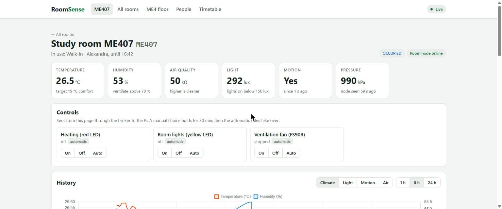

---

## The problem

University teaching rooms are heated and lit on a fixed schedule, whether or not anyone is inside. We imported the university timetable (ADE) for the seven rooms of the ME4 floor: over the five teaching weeks from 16 November to 18 December 2026, classes fill only **about 30 % of opening hours** (08:00–19:00, Mon–Fri), from 44 % in mid-November down to 8 % in mid-December. The floor is heated for roughly **1 350 room-hours with nothing scheduled**.

RoomSense is a room that knows whether it is booked and whether anyone turned up, and drives its own heating, lights and ventilation from that. It was built for one real room (study room **ME407**) with a Raspberry Pi; the server, database and dashboard are designed to scale to a whole floor.

The project contributes to **UN SDG 7** (target 7.3, energy efficiency), and also to SDG 11 and SDG 12.

## Architecture

```
 Raspberry Pi 3 (room node)  --MQTT 1883-->  RoomSense server (Node.js)  --driver-->  MongoDB 6
   PIR, BME680, VEML7700,                    Aedes broker + validation
   RDM6300 RFID, LEDs, servo fan             + room logic + REST API
                                                   ^  HTTP 3000 (REST + server-sent events)
                                                   |
                                             Angular 19 dashboard
```

The key design decision: **the MQTT broker runs inside the server process** (Aedes). The broker, the database writer, the room logic and the API are one component with one MongoDB connection. The Pi talks MQTT only (no database driver, no HTTP, no room logic) and the dashboard talks HTTP only.

## Hardware

| Part | Role | Interface |
|---|---|---|
| Raspberry Pi 3 | Room node | Wi-Fi / Ethernet to the broker |
| PIR motion sensor | Presence | GPIO 17 |
| BME680 | Temperature, humidity, pressure, gas resistance (air quality) | I2C 0x76 |
| VEML7700 (replaced a TSL2591) | Illuminance (lux) | I2C 0x10 |
| RDM6300 125 kHz RFID reader | Badge identification | UART 9600 baud, via 2.2 kΩ / 3.3 kΩ divider to GPIO 15 |
| Status LED | Free / reserved (blinking) / occupied | GPIO 27 |
| Red LED | Stands for the heating relay | GPIO 22 |
| Yellow LED (PWM) | Room lights, dimmable | GPIO 13 |
| FS90R continuous servo | Ventilation fan | GPIO 18 (hardware PWM via pigpio) |

The LEDs stand in for relays: the server's commands would drive a relay module without any server-side change.

## Wiring guide

**[Open the interactive wiring guide](https://usmanashfaq14.github.io/RoomSense-IoT/wiring-guide.html)**: each step highlights its wires on a drawing of the Pi and both breadboards (source: [`docs/wiring-guide.html`](docs/wiring-guide.html)). Each step is shown as an image below.

The circuit uses **one Raspberry Pi 3 and two breadboards**:
- **Breadboard 1** holds the sensors (BME680, VEML7700, RDM6300 RFID). Its **top rails carry 3.3 V** and its **bottom rails carry 5 V**.
- **Breadboard 2** holds the outputs and the PIR (three LEDs, PIR, FS90R servo). It takes 5 V and GND from breadboard 1.

Pins below are **physical header pin numbers** (GPIO numbers in brackets, BCM). Columns count from each breadboard's left end; rows are lettered a–j. Wire colours are suggestions, but keep **red for 5 V and black for GND**.

### Pi pin map

| Pi pin | Signal | Goes to |
|---|---|---|
| 1 | 3V3 | Breadboard 1 top + rail (3.3 V) |
| 2 | 5V | Breadboard 1 bottom + rail (5 V) |
| 6 | GND | Breadboard 1 top − rail |
| 14 | GND | Breadboard 1 bottom − rail |
| 3 | GPIO2 (SDA) | BME680 SDA (col 3, row c), shared with the VEML7700 |
| 5 | GPIO3 (SCL) | BME680 SCL (col 4, row c), shared with the VEML7700 |
| 10 | GPIO15 (RXD) | RFID divider middle (col 8, row f) |
| 11 | GPIO17 | PIR OUT (board 2, col 23, row c) |
| 12 | GPIO18 | FS90R signal / orange (board 2, col 30, row c) |
| 13 | GPIO27 | Status LED (board 2, col 3, row a) |
| 15 | GPIO22 | Heating LED (board 2, col 9, row a) |
| 33 | GPIO13 | Room-lights LED, PWM (board 2, col 15, row a) |

### Before you start

- Switch the Pi off and unplug it while wiring. Have the circuit checked before the first power-on.
- Enable I2C (`sudo raspi-config` → Interface Options → I2C) and the serial port for the RFID reader. Add `dtoverlay=pi3-disable-bt` and `enable_uart=1` to `/boot/config.txt`. In `raspi-config` → Serial, set login shell *No* and serial port *Yes*. Remove `console=serial0,115200` from `cmdline.txt`, run `sudo systemctl disable hciuart`, then reboot.

> ⚠️ **Three rules that protect the Pi**
> 1. Never join breadboard 1's 3.3 V rail (top) to any 5 V rail.
> 2. The RFID reader's TX is a 5 V signal: it reaches the Pi **only through the 2.2 kΩ / 3.3 kΩ divider**.
> 3. Breadboard 2 takes its power from breadboard 1's **bottom (5 V)** rails, never the top 3.3 V rail.

In each image, the bright wires belong to that step, faded wires were added in earlier steps, and the card on the right lists every connection. For an interactive version, use the [live guide](https://usmanashfaq14.github.io/RoomSense-IoT/wiring-guide.html).

### Step 1: Breadboard 1 power rails
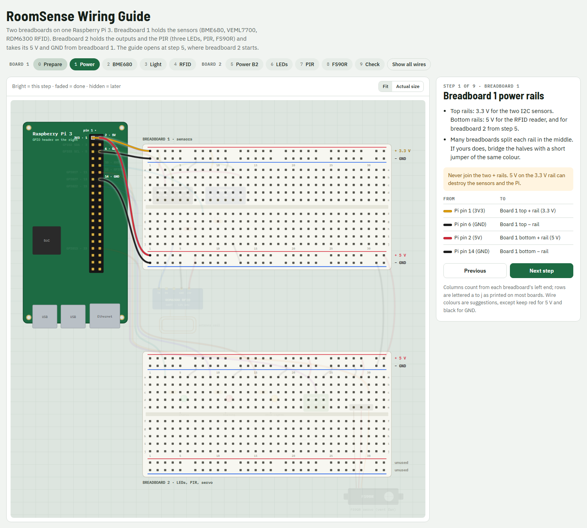

### Step 2: Climate sensor (BME680)
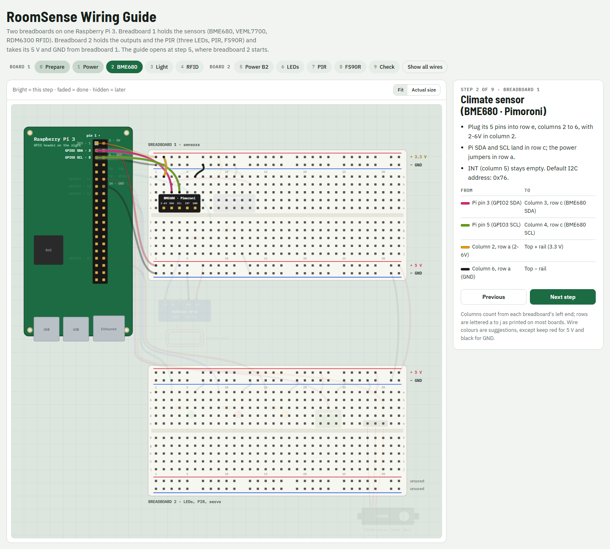

### Step 3: Light sensor (VEML7700)
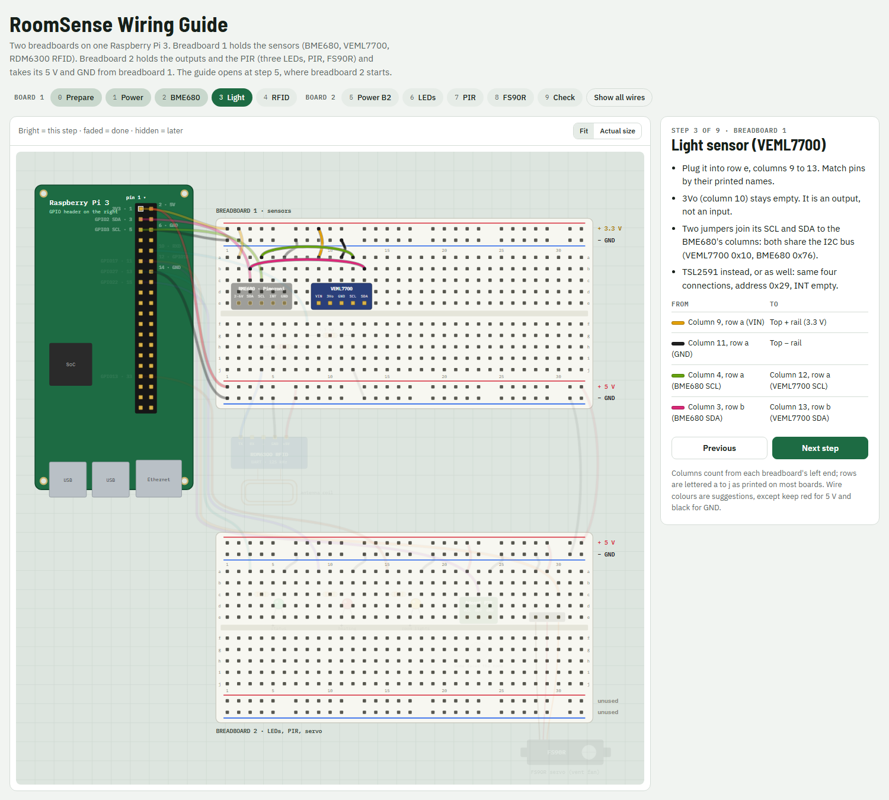

### Step 4: RFID reader (RDM6300) and voltage divider
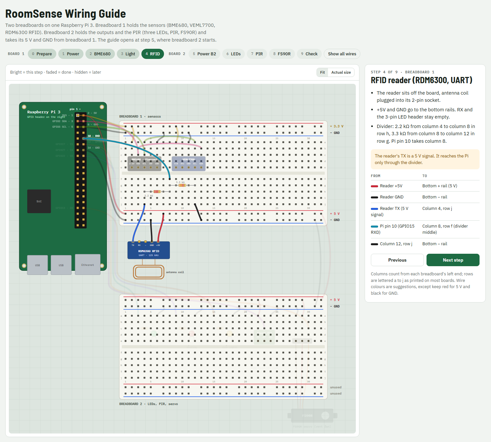

### Step 5: Power breadboard 2
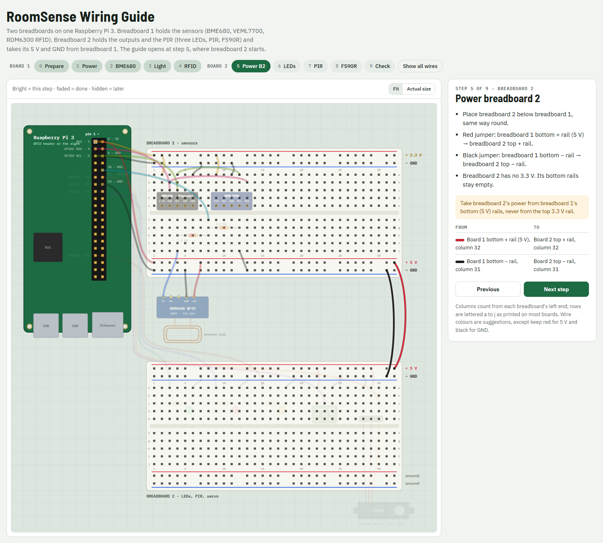

### Step 6: Three LEDs (status, heating, room lights)
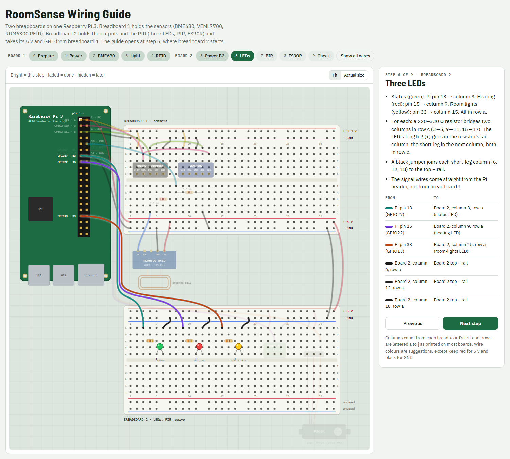

### Step 7: Motion sensor (PIR)
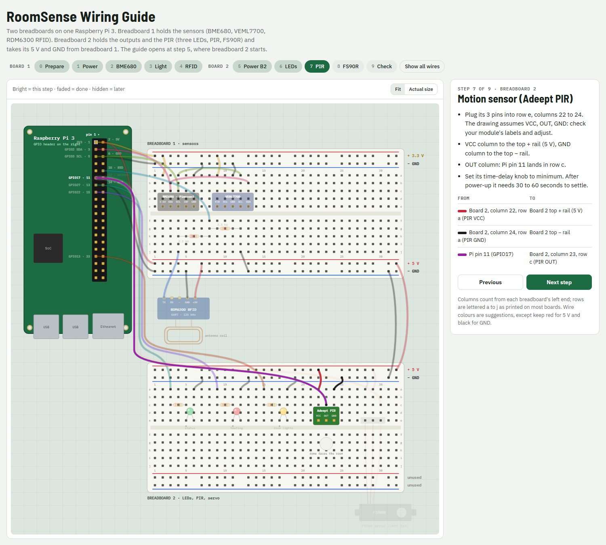

### Step 8: FS90R servo (ventilation fan)
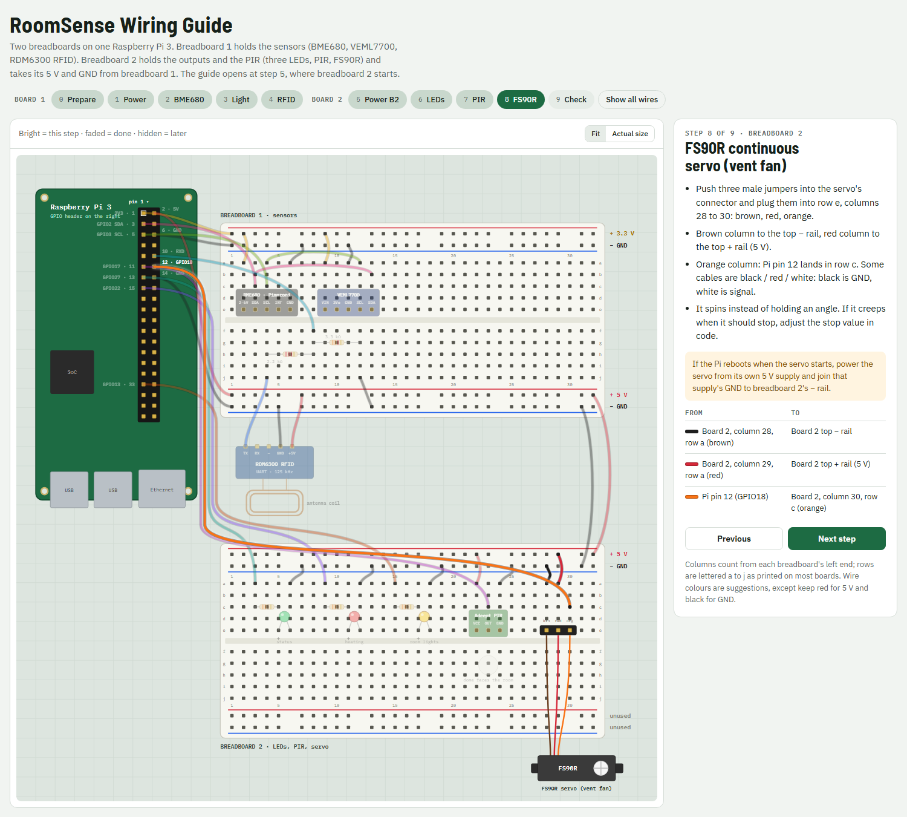

### Complete wiring
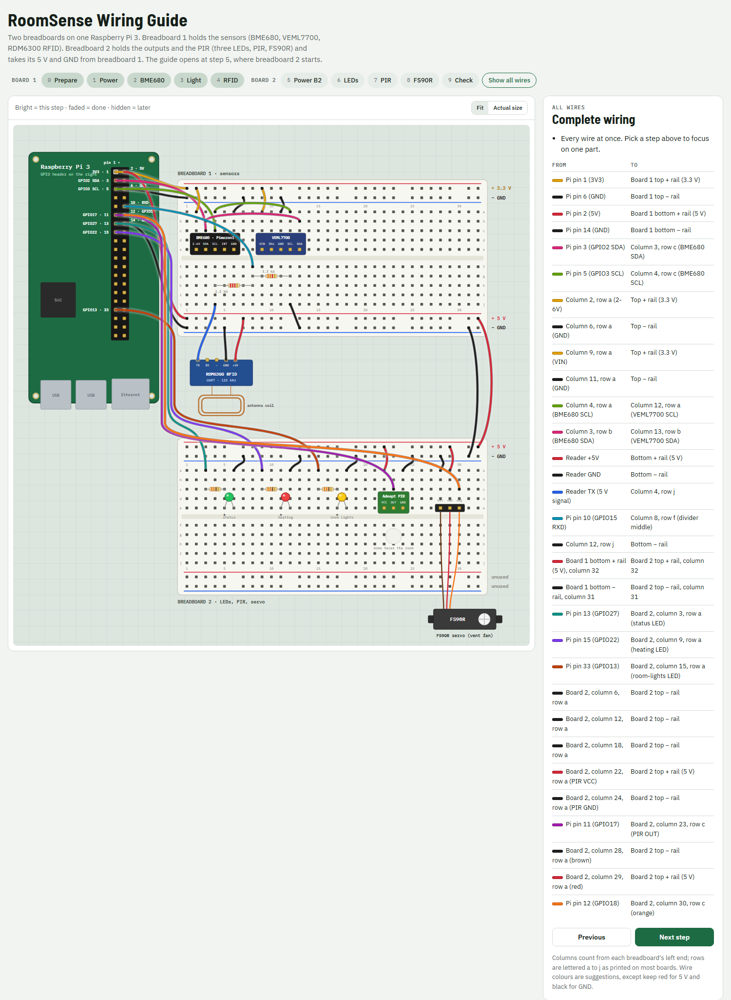

When everything is wired, power on and run `python3 check_hardware.py all` in `server/`. It tests each part on its own, from the I2C scan (expects `0x10` and `0x76`) to an MQTT round trip.

## Room logic

A room is **FREE**, **RESERVED** or **OCCUPIED**, driven by bookings, badges and presence:

- **Check-in**: the booker's badge or, for a timetabled class, any registered badge or motion after the start.
- **No-show**: nobody checks in within 10 min of the start → room back to FREE, heating to eco.
- **Release**: no motion for 30 min → occupied room released; lights off after 15 min.
- **Walk-in**: a registered badge on a free room books it for up to 60 min, never past the next booking.
- **Not watched, not judged**: a booking is marked no-show/released only if the node was online from its start; otherwise it ends as *unmonitored*.

| Actuator | Rule | Baseline it replaces |
|---|---|---|
| Heating | comfort 19 °C when RESERVED/OCCUPIED, eco 16 °C when FREE (±0.5 °C hysteresis) | comfort during all opening hours |
| Lights | on when OCCUPIED, motion in last 15 min, and below 150 lux | on for the whole booked time |
| Fan | on when OCCUPIED and the air-quality alert is set | no on-demand ventilation |
| Status LED | free / reserved / occupied / offline | none |

Any actuator can be driven from the dashboard (`POST /api/rooms/:id/actuators/:name`); a manual command pauses the automatic rule for 30 min, and "Auto" hands it back.

## MQTT topics (base `campus/<room>/`)

| Direction | Topic | Payload |
|---|---|---|
| Pi → server | `sensor/presence` | `{ts, presence}` on change |
| Pi → server | `sensor/climate` | `{ts, celsius, humidity, hPa, gasOhms, gasReady}` on change or every 5 min |
| Pi → server | `sensor/light` | `{ts, lux, saturated}` on change or every 5 min |
| Pi → server | `sensor/rfid` | `{ts, uid}` QoS 1 |
| Pi → server | `node/status` | `online` / `offline` (retained, Last Will) |
| Pi → server | `actuator/<name>/state` | echo of the applied command |
| server → Pi | `actuator/{status,heating,light,fan}/set` | retained, QoS 1 |
| server → Pi | `rfid/result` | `{granted, reason}` |

Every payload is validated for type and range before storage; each Pi has its own MQTT account (salted scrypt hash) and may publish only under its own room.

## Database (MongoDB 6)

Six collections, each with a `$jsonSchema` validator created at start-up:

| Collection | Holds | Lifetime |
|---|---|---|
| `rooms` | one document per room: state, setpoints, timings, last actuator states | kept |
| `users` | people and badges (badge stored as SHA-256 hash only) | kept |
| `bookings` | user bookings, walk-ins, timetable classes | kept |
| `sensor_readings` | **time-series collection**, one value per document | 30 days (TTL) |
| `events` | activity log (19 event types) | 365 days (TTL) |
| `daily_stats` | per room/day usage and estimated energy avoided | kept |

## Dashboard (Angular 19 + Chart.js)

- **All rooms**: state, sensor or timetable-only, air-quality warning, current/next booking.
- **Room page**: live strip with countdowns, live values, On/Off/Auto controls, day timeline, history charts, bookings, settings, statistics, activity log.
- **ME4 floor**: scheduled hours, empty hours and avoidable heating per room for any week, plus a term view.
- **People**: users and badges; register an unknown badge in one click.
- **Timetable**: import an ADE `.ics` export.

Live updates use server-sent events (`GET /api/stream`), no polling. The dashboard was audited against **RGAA 4.1**: after fixes, axe-core reports no violations on any page in light or dark mode.

| | |
|---|---|
| 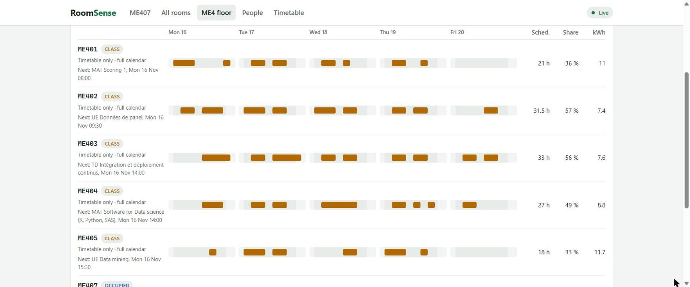 | 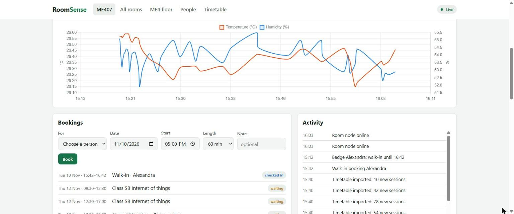 |

## Results

- **Publish-on-change** on the Pi cut messages by 91 % (climate) and 99 % (light) in a live session.
- **Ten hours unattended** (12–13 Nov): 10 h 19 min with no broker drop and no standalone episode; ~7 370 climate and ~18 500 light reads became 136 and 157 messages.
- A real **no-show** at 09:40 on 13 Nov returned the room to eco automatically.
- **ME4 floor timetable analysis** (7 rooms, 358 classes):

| Week | Scheduled share | Empty open hours | Heating avoidable (estimate) |
|---|---|---|---|
| 16–20 Nov | 44 % | 215 h | 68 kWh |
| 23–27 Nov | 42 % | 224 h | 71 kWh |
| 30 Nov – 4 Dec | 38 % | 240 h | 76 kWh |
| 7–11 Dec | 17 % | 320 h | 101 kWh |
| 14–18 Dec | 8 % | 355 h | 112 kWh |
| **5 weeks** | **≈ 30 %** | **≈ 1 350 h** | **≈ 425 kWh** |

Energy figures are estimates (1.5 kW heater per room, ADEME rule of 7 % per degree, 3 °C setback); the scheduled hours come straight from the university timetable.

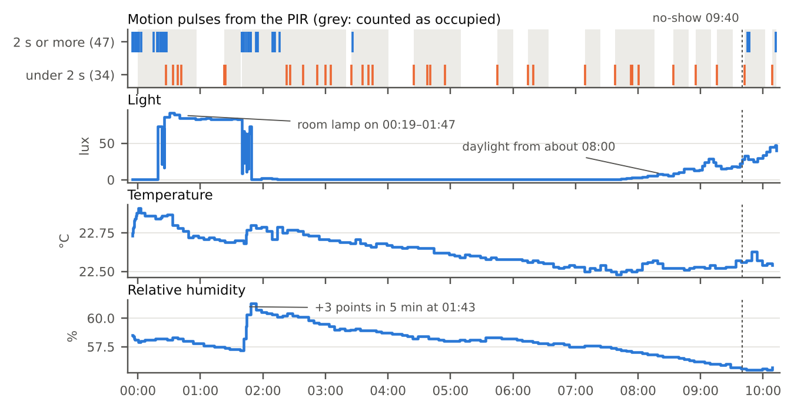

## Testing and robustness

- **141 automated server checks** (`npm test`, no MongoDB or Pi needed): 113 room-logic checks with a controlled clock, 28 end-to-end checks with the real broker and the real Pi program on simulated GPIO.
- **25 Pi-side fault-handling checks**: standalone mode, pigpio link rebuild, missing sensor at start-up, VEML7700 driver.
- **Hardware check** (`check_hardware.py`): I2C scan, every sensor and actuator, MQTT round trip — 8/8 PASS.
- **Eight robustness scenarios on real hardware**: forbidden MQTT traffic, server restart, Pi power cut, Wi-Fi drops (45 s and 90 s), sensor unplugged, GPIO service restart, MongoDB stopped, plus the overnight run. Each problem found was fixed and the scenario re-run.

The Pi node handles faults on its own: it rotates through broker addresses with back-off, falls back to **standalone mode** after 60 s without a broker (heating eco, lights follow motion and daylight), retries missing sensors every 5 s and rebuilds the pigpio link if it breaks.

## Security and privacy

- MQTT logins with per-room rights; passwords stored only as salted scrypt hashes.
- Badges stored as SHA-256 fingerprints; the timetable parser never reads teacher names.
- Raw readings kept 30 days, events 365 days; presence is per room, never per person.
- The REST API (no login yet) listens only on localhost by default; only the MQTT port is open to the network.

## Repository layout

```
roomsense-server/     Node.js server: embedded Aedes broker, room logic, REST API, MongoDB schema, tests
roomsense-dashboard/  Angular 19 dashboard
server/               Raspberry Pi node (roomsense_node.py) and hardware check / debug scripts
report-pack/          Figures, screenshots, overnight data, accessibility and test results used in the report
docs/                 Interactive wiring guide (wiring-guide.html)
Extra/                Offline Python wheels for the Pi, an earlier server prototype
events.json, timeline.json, night.txt   Exported data from the overnight run
```

## Getting started

**Requirements:** Node.js 20+ (tested on 22), MongoDB 6+ on `mongodb://127.0.0.1:27017`, a Raspberry Pi with Python 3 for the node.

### Server

```bash
cd roomsense-server
npm install
node scripts/mqtt-user.js add node-ME407 --room ME407   # once: MQTT account for the Pi (prints the password once)
npm start                                               # http://localhost:3000/api/health
npm test                                                # 141 checks, no MongoDB needed
```

Demo mode (one room-logic minute = one second, on a separate `roomsense_demo` database):

```bash
npm run demo-setup
npm run demo
```

See [`roomsense-server/README.md`](roomsense-server/README.md) for environment variables, all topics and API endpoints.

### Dashboard

```bash
cd roomsense-dashboard
npm install
npm start          # dev server on http://localhost:4200
npm run build      # production build, then served by the server on http://localhost:3000
```

### Raspberry Pi node

```bash
pip install paho-mqtt gpiozero pigpio bme680 smbus2 pyserial
sudo pigpiod
echo "<password from mqtt-user.js>" > mqtt-password.txt
python3 roomsense_node.py --broker <server-ip> --room ME407
python3 check_hardware.py   # optional: test every part on its own
```

## Libraries

No external services (no cloud broker, hosted database or web API). Every library is justified:

| Library | Where | Why |
|---|---|---|
| aedes | server | MQTT broker inside the Node process; per-room auth hooks |
| express | server | REST API and server-sent events |
| mongodb | server | Official driver; validators, time series and TTL used directly, no ODM |
| compression | server | gzip: dashboard download 300 kB → 86 kB |
| mqtt | server (dev) | Test client for end-to-end tests |
| paho-mqtt | Pi | Reference Python MQTT client: Last Will, QoS, reconnection |
| gpiozero + pigpio | Pi | GPIO classes; hardware-timed PWM so the servo doesn't jitter |
| bme680 | Pi | The breakout's own driver |
| smbus2 | Pi | I2C for the VEML7700 via our own small driver |
| pyserial | Pi | UART frames from the RDM6300 |
| Angular 19, Chart.js 4 | dashboard | Course framework; time-axis and bar charts |

## Limitations and future work

- A PIR sees motion, not people: a CO₂ sensor or door counter would measure occupancy better.
- Energy savings are estimates; a plug-in meter on a real radiator would turn them into measurements.
- Only ME407 has a node; adding a room takes one Pi and one MQTT account.
- No TLS (MQTT on 8883 is next), no dashboard login, no statistics export yet.
- LEDs stand in for relays; next step is a relay module on a real radiator or light circuit.
- Short PIR noise pulses overnight should be filtered on the node (ignore pulses under 2 s).
